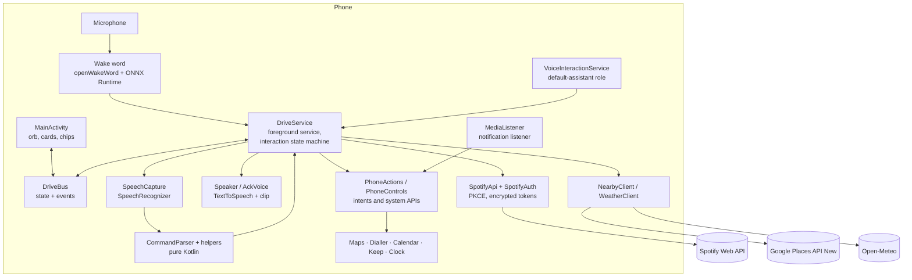

# DriveBuddy

**A hands-free voice buddy for the driver's seat.** Say "Hi Oreo", get an instant spoken acknowledgement, and ask for what you need: navigate, call, text, play music, set a timer, find a petrol pump. All without touching the phone, and without opening the app.

Built for one phone (OnePlus Nord 5, Android 15) and one driver, in Kotlin. Open-source parts wherever possible, no paid services, no backend of its own.

---

## Contents

1. [Why this exists](#why-this-exists)
2. [What it can do](#what-it-can-do)
3. [How an interaction flows](#how-an-interaction-flows)
4. [Architecture](#architecture)
5. [Technical design](#technical-design)
6. [Data, privacy and security](#data-privacy-and-security)
7. [Cost and quota design](#cost-and-quota-design)
8. [Product and business design](#product-and-business-design)
9. [Logging and diagnostics](#logging-and-diagnostics)
10. [Testing](#testing)
11. [Build and setup](#build-and-setup)
12. [Permissions](#permissions)
13. [Known limitations](#known-limitations)
14. [Roadmap](#roadmap)
15. [Credits and licences](#credits-and-licences)

---

## Why this exists

Google Assistant stays silent after "Hi Google"; you wait, unsure it heard you. Siri answers with a quick "Mhm". That half-second of feedback is the difference between trusting a voice assistant and fighting it, and in a car with no Bluetooth and no steering-wheel button, the voice assistant is the only safe interface.

DriveBuddy is the answer to that one pain point, grown into a "holistic buddy" rather than a bag of commands:

- **Instant acknowledgement.** A short spoken clip plays the moment the wake word is heard.
- **Always reachable.** Runs as a foreground service and as the phone's assistant, so it works with the app closed and the screen locked.
- **Uses the phone's own apps.** Maps for navigation, Spotify for music, Calendar for reminders, Keep for notes, the Clock app for timers and alarms. Nothing is reinvented, nothing is duplicated.
- **Honest about failure.** It says what went wrong ("Spotify isn't connected") instead of going quiet.

It is a personal tool and a portfolio project, not a product for sale (see [Product and business design](#product-and-business-design)).

---

## What it can do

Phrases below are examples; the parser accepts natural variations.

| Area | What you can say | How it is done |
|---|---|---|
| **Wake and acknowledge** | "Hi Oreo" or tap the orb | Custom on-device wake-word model, then a short spoken ack clip |
| **Navigation** | "Navigate to Home", "Take me to Indiranagar" | Saved places and free-form addresses, opened in Google Maps. Last trips are remembered |
| **Calls** | "Call Papa" | Contacts name matching, then the system dialler. Works on a locked phone |
| **Text messages** | "Text Papa I'm on my way" or "Text Papa" then dictate | Reads the message back, asks yes/no, confirms real delivery with sent-intent callbacks |
| **Music (Spotify)** | "Play Husn by Anuv Jain" | Spotify Web API search, best-match picking, verified playback |
| | "Play a song by Anuv Jain" | Plays the artist, shuffled |
| | "Play any song" | Plays your Liked Songs, shuffled |
| | "Play my playlist driving", "a song from any of my playlists" | Plays your playlist, shuffled |
| | "Pause", "next", "previous", "stop" | System media session control |
| **Volume** | "Volume up", "set volume to 60", "mute" | Audio manager, reports before and after |
| **Timers and alarms** | "Set a timer for 10 minutes", "Alarm at 6:30 AM" | The Clock app's own intents |
| **Reminders** | "Remind me to call the bank in 2 hours" | Created as Google Calendar events |
| **To-dos and notes** | "Add milk to my shopping list", "Note: parking is on level 3" | Handed to Google Keep |
| **App launching** | "Open WhatsApp" | Fuzzy matching on installed apps. Works on a locked phone |
| **Phone controls** | "Flashlight on", "Do not disturb on" | Camera torch and notification-policy APIs |
| **Weather** | "What's the weather?" | Open-Meteo, from your location |
| **Nearby places** | "Find a petrol pump near me" | Google Places search, nearest three on a full-screen picker (tap or say 1, 2, 3, "more", "cancel"), then navigate |
| **Follow-up questions** | Any "which one?" or "shall I send it?" | The assistant listens again without needing the wake word |

Interruption works too: tap the orb while it is speaking and it stops and listens.

---

## How an interaction flows

```
"Hi Oreo"
   │  wake-word model fires (score ≥ 0.7, two frames in a row, loudness check)
   ▼
ack clip plays ──► music pauses ──► speech recogniser listens
   │
   ▼
transcript ──► CommandParser (pure Kotlin, rule-based) ──► Command
   │
   ▼
DriveService.respond(command)
   ├─ speaks a reply (TTS, with audio focus)
   ├─ then performs the action (Maps, call, Spotify, …)
   └─ or asks a follow-up and listens again
   │
   ▼
finishInteraction: log latency, resume music if appropriate, resume wake-word listening
```

Every stage is timed by a latency tracker and written to the log, so a slow interaction can be explained rather than guessed at.

---

## Architecture



### Main components

| Component | Responsibility |
|---|---|
| `DriveService` | The heart. Foreground service (microphone type). Owns the interaction state machine, follow-up questions, watchdog, audio focus and the wiring between every other piece |
| `DriveVoiceService`, `DriveSessionService`, `DriveRecognitionService` | Register DriveBuddy as an Android assistant, which exempts it from background-start limits so the wake word can launch a session with the app closed |
| `audio/OpenWakeWord`, `audio/WakeWord` | Wake-word detection loop on a background thread |
| `audio/SpeechCapture` | `SpeechRecognizer` wrapper: on-device engine preferred, restart-after-pause and release-after-each-result to avoid "busy" races |
| `audio/Speaker`, `audio/AckVoice`, `audio/Cue` | Text-to-speech, the "Mhm" ack clip, and short listening/ack beeps |
| `core/*` | Pure-Kotlin logic with no Android dependency, unit-tested (see [Testing](#testing)) |
| `PhoneActions`, `PhoneControls` | Calls, SMS, navigation, app launch, torch, DND, timer, alarm, note, reminder, volume, media control |
| `spotify/*` | OAuth with PKCE, encrypted token vault, search, playback, playlist and library reads |
| `NearbyClient`, `WeatherClient`, `LocationHelper` | Network lookups and location |
| `OverlayAnchor` | A tiny overlay window so Maps and Spotify may be opened from the background |
| `MediaListener` | Notification-listener service giving access to active media sessions |
| `DriveState`, `DriveBus` | UI state, choice cards and tap events, shared between service and screen |
| `MainActivity`, `SettingsActivity`, `SetupActivity`, `PlacesActivity`, `JourneyActivity` | Home screen, settings, first-run permission prompts, saved places, trip history |
| `SavedPlaces`, `Journeys` | Small JSON stores for named places and the last ten trips |
| `ui/OrbView`, `ui/SettingsIconView` | The floating amber-to-violet orb and header icon |

---

## Technical design

### Wake word
- **Pipeline:** openWakeWord's `melspectrogram.onnx` → `embedding_model.onnx` → a custom-trained `hi_oreo.onnx`, run with `onnxruntime-android`.
- **Why custom:** off-the-shelf engines struggled with the owner's accent and with music playing in the car. A purpose-trained model for "Hi Oreo" fired on the first attempt.
- **False-trigger control:** threshold 0.7, patience of 2 consecutive frames, plus a loudness check. The word "Oreo" alone can still trigger it (a conscious choice to leave it).
- **Why not Bluetooth or a button:** the car has neither, so the wake word is the only hands-free trigger. The power button is deliberately untouched.

### Always-on, no app open
- Runs as a microphone-type foreground service with a persistent notification offering Talk and Stop.
- Registers as the phone's default assistant. That status lets the service start from the background on Android 14 and later, which is what makes "Hi Oreo" work with the app closed.
- The service is deliberately **not sticky**: Android 14 and later will not let a killed microphone service restart itself, so it is started again by the assistant role or the user.

### Speech and speaking
- **Recognition:** Android `SpeechRecognizer`, on-device where available. The recogniser is released after every result, and restarted after the music-pause settles.
- **Acknowledgement:** a prerecorded "Mhm" clip plays first; listening begins only after it finishes, plus a short gap, so the assistant never hears itself.
- **Replies:** Android `TextToSpeech` under navigation-guidance audio focus. Music ducks or pauses, then resumes unless the command was itself a music command.
- **Watchdog:** a 15-second timer ends any interaction the recogniser never answers. Long network operations (location, search, Spotify wake-up) cancel it and own their own limits.

### Command understanding
- **Rule-based and on-device.** `CommandParser` turns a transcript into a sealed `Command`. No cloud language model is involved, so latency is near zero and nothing about what you say is sent anywhere for interpretation.
- **Order matters.** Stop phrases → media → play → call → navigate → weather → SMS → memory (notes, lists, reminders) → on/off switches → clock → open app → nearby → volume → echo. Music titles are matched before generic phrases so a song called "Turn Down for What" still plays.
- **Play requests** go through `PlayIntent`, which distinguishes a named song, an artist, "any song", a named playlist, and "any playlist", checking playlist phrases before artist phrases.
- **Matching helpers:** `NameMatcher` (contacts), `AppMatcher` (installed apps), `TrackPicker` (search results), `AlarmTime`, `ReminderTime`, `SmsText`, `YesNo`, `PlaceChoice`, `WeatherText`, `NearbyText`, `SongQuery`.

### Choosing the right song
Spotify's top search result is a popularity-weighted guess, and since February 2026 its API no longer returns popularity at all. DriveBuddy therefore:
1. Turns "X by Y" into a field search (`track:"X" artist:"Y"`), retrying with plain words if that finds nothing (titles like "Stand by Me" contain "by").
2. Picks among up to 10 results by matching what you said against titles and artists, ignoring filler words, tolerating a one- or two-letter recogniser slip.
3. **Refuses to play when nothing plausibly matches**, and says so, rather than playing a random song.
4. Starts playback by album context plus offset (the form that reliably plays), then checks `/me/player` to verify the right track is actually playing.

### Follow-up conversations
`ask` / `askYesNo` / `startFollowUp` let any feature pose a question. After speaking it, the service listens again without a wake word. A mumbled yes/no is asked once more, then treated as no. This powers SMS confirmation, "what should I say?", the pick-one list and the location-settings prompt.

### Nearby places and the pick-one overlay
1. Location is read from the platform `LocationManager` (permission and the location switch are checked first, with a spoken offer to open settings).
2. A Google Places (New) Text Search runs with a deliberately cheap field mask (`displayName`, `location`).
3. Results are ranked by distance and offered three at a time, spoken and shown on a full-screen card overlay. Each card is tappable; "More" fetches the next three; "Cancel" closes.
4. A tap interrupts the read-out and navigates immediately. A spoken "two" does the same. The chosen place is recorded as the last trip.
5. If the app is not in front (Maps is open), the assistant brings it forward so the list is visible.

### Spotify
- **Auth:** OAuth 2.0 with PKCE (no client secret exists to leak). Tokens are encrypted with an Android Keystore AES-GCM key (`TokenVault`).
- **Playback:** needs Spotify Premium and Spotify installed. If the phone has no active device, DriveBuddy opens Spotify and waits up to about six seconds for it to appear.
- **Shuffle** is turned on for artists, Liked Songs and playlists, and turned off again for a specific song.
- **Scopes:** playback control, library read (Liked Songs) and playlist read. Adding scopes needs a one-time "Connect Spotify" again.

### Navigation and background launching
Maps is started with a `google.navigation:` intent. Android blocks background activity launches, so a small overlay window (`OverlayAnchor`, "Display over other apps") is shown during an interaction. That visible window is what allows Maps, Spotify and the Clock app to open while the screen is locked.

### State and UI
`DriveBus` is a small in-process event bus carrying the interaction state, status text, choice cards and tap events between the service and the activity. The UI is a single dark "night instrument" screen: a floating amber-to-violet orb, one headline, one status line, suggestion chips, the last trip, and a red "End session" pill.

### Storage
Only small things, all on the phone: encrypted Spotify tokens, saved places (JSON), the last ten trips (JSON), and a rolling latency log. Reminders live in Calendar and notes in Keep; DriveBuddy keeps no memory store of its own on purpose.

---

## Data, privacy and security

### What leaves the phone

| Service | What is sent | When |
|---|---|---|
| Android speech recogniser | Audio of your request | Each request. On-device when the engine supports it, otherwise the system's online recogniser |
| Spotify Web API | Search text, playback commands, your token | Music requests |
| Google Places API | The place type you asked for and your coordinates | "Find … near me" |
| Open-Meteo | Your coordinates, rounded to about 1 km | "What's the weather?" |
| Google Maps | The destination | Navigation (via the Maps app, not DriveBuddy) |

There is no DriveBuddy server, no analytics SDK and no account.

### Safeguards
- **Wake-word audio stays on the phone.** Detection is fully on-device.
- **Secrets stay out of git.** The Maps/Places key lives in `local.properties` (git-ignored) and reaches the app through `BuildConfig.MAPS_API_KEY`. The Spotify client ID is committed on purpose: with PKCE it is not a secret.
- **Tokens encrypted at rest** with a hardware-backed Keystore key.
- **Logs never contain** phone numbers, message text or addresses. Contact names, search text and place names may appear, since the app is single-user and the log is the owner's.
- **Confirmation before sending** any text message.
- **Least privilege:** each permission exists for a named feature (see [Permissions](#permissions)); permissions are requested on first run and can be re-toggled from Settings.
- **Locked-phone policy:** calls, texts and app launching deliberately keep working on a locked phone, because that is exactly when you are driving.

---

## Cost and quota design

The standing rule: **no spend, other than a card on file for Google Cloud, and only while usage stays inside free limits.**

| Piece | Cost | Control |
|---|---|---|
| Wake word, parsing, TTS, recognition | Free (on-device) | n/a |
| Spotify Web API | Free; needs the owner's Premium for playback | Development-mode app, single user |
| Open-Meteo | Free, no key, non-commercial use | Attribution below |
| Google Places (New) | Free monthly allowance (about 5,000 Pro-tier requests per month) | Cheap field mask (no ratings or opening hours); hard quotas of about 30 requests per day and 10 per minute in Cloud Console |
| Google Maps navigation | Free (uses the installed app) | n/a |

Because quotas are enforced by Google rather than by the app, a bug or a loop cannot generate a bill. At the owner's expected use (a handful of nearby searches a month) the allowance is not approached.

---

## Product and business design

### Positioning
A **personal-use, portfolio-grade** assistant. It is not a public product and has no monetisation plan. Its value is two things: it fixes the owner's daily annoyance, and it is a demonstrable piece of engineering (on-device ML, Android system integration, third-party APIs, careful UX, tests and diagnostics).

### The user and the job
- **User:** one driver, one phone, English only, often in noisy conditions with music playing.
- **Job to be done:** "Let me do the handful of things I do in the car, by voice, quickly, and trust that it heard me."
- **Success measures (personal, not commercial):** wake word fires first time in the car; ack heard within about a second of the wake word; a request completes without touching the phone; no wrong-song or wrong-contact surprises; no bill.

### Design principles
1. **Acknowledge first.** Feedback in under a second beats a smarter but silent assistant.
2. **Reuse the phone.** Prefer the apps and features already installed over writing our own logic or depending on outsiders.
3. **Never guess silently.** Say what was understood, ask when ambiguous, admit when nothing matched.
4. **Safe by default while driving.** Confirm before sending, keep replies short, and prefer voice or one-tap choices over reading.
5. **Cheap and private.** On-device wherever possible, no backend, no ongoing cost.
6. **Diagnosable.** Enough logging to explain any interaction after the fact.

### Scope decisions (and why)
| Decision | Reason |
|---|---|
| Rule-based parser, not a cloud LLM | Zero latency, zero cost, private; the command set is bounded |
| Spotify Web API over search-intent launching | Intents opened search but did not play; hands-free playback was a major requirement |
| Open-Meteo over reading the OnePlus Weather app | Works on any phone; reading another app's data was judged overkill |
| Calendar for reminders, Keep for notes | No second memory store to maintain; the phone's own apps already sync |
| No calling by number | Judged unnecessary |
| No genre playback ("play a rap song") | Skipped for this milestone; Spotify's genre content is awkward for development-mode apps |
| No Bluetooth toggling | Blocked for apps on Android 13 and later |
| Wake phrase "Hi Oreo", English only | Matches the owner's choice and the trained model |

### Risks and mitigations
| Risk | Mitigation |
|---|---|
| Spotify tightens development-mode access (it did in Nov 2024 and Feb 2026) | Use only core playback endpoints; keep Spotify behind one small class; fail with a spoken reason |
| Android restricts background microphone or activity launches further | Assistant role plus overlay anchor; service designed to restart cleanly |
| Recogniser mishears names and titles | Fuzzy matching, refuse-on-no-match, confirm-by-voice; recogniser hint phrases planned |
| Google pricing or free allowance changes | Hard quotas in the console, cheap field mask, a single client class |
| Battery and always-on microphone | Wake-word model is small and runs on one background thread; sessions can be ended from the home screen |
| Distraction while driving | Short spoken replies, large tap targets, voice-first flows |

---

## Logging and diagnostics

- **One tag:** `DriveBuddy`. Filter Logcat on it.
- **Levels:** `i` for flow milestones (state changes, transcripts, decisions), `d` for detail, `w` for recoverable problems, `e` for failures.
- **Every interaction** logs: trigger, state transitions, transcript and engine, routed command, spoken reply, action result, and (for Spotify) the HTTP status of each call plus a player check after playback.
- **A latency tracker** timestamps trigger, listening, speech end, ack, final transcript, routing and speech start/finish, and appends a JSON line per interaction so slow stages are obvious.
- **Never logged:** phone numbers, message bodies, addresses.

---

## Testing

Everything that can be Android-free is, so it can be unit-tested on the JVM: `CommandParser`, `PlayIntent`, `SongQuery`, `TrackPicker`, `NameMatcher`, `AppMatcher`, `AlarmTime`, `ReminderTime`, `SmsText`, `YesNo`, `PlaceChoice`, `WeatherText`, `NearbyText`, `Pkce`.

```
./gradlew test
```

Anything involving the microphone, Maps, Spotify, location or the lock screen is tested by hand on the device, driven by the log lines described above. A recommended manual checklist before a drive: wake from locked screen; "navigate to home"; "call" a contact; send a text; play a named song, an artist, "any song", a playlist; "stop"; a nearby search with a tap and with a spoken pick.

---

## Build and setup

**Requirements:** Android Studio, a physical Android 15 phone (the wake word and assistant role cannot be tested on an emulator), Spotify Premium for music.

1. **Clone** the repo and open it in Android Studio.
2. **Maps / Places key.** Create a Google Cloud project, enable *Places API (New)*, add a billing card, create an API key restricted to your app and that API, and set quotas (about 30 `SearchText` requests per day and 10 per minute). Then add to `local.properties` (never commit it):
   ```
   MAPS_API_KEY=your_key_here
   ```
3. **Spotify.** Create an app in the Spotify Developer Dashboard, add your account as a user, set the redirect URI used in `SpotifyAuth`, and put the **client ID** in the code (PKCE needs no secret).
4. **Wake-word models.** Place `melspectrogram.onnx`, `embedding_model.onnx` and your trained `hi_oreo.onnx` in the app's assets. The training notebook used for the custom model is included in the project notes.
5. **Ack clip.** Put the acknowledgement audio in `res/raw/ack.mp3`.
6. **Run** the app. The setup screen prompts for each permission in turn.
7. **Make it the assistant.** Android Settings → Apps → Default apps → Digital assistant app → DriveBuddy, so it can start with the app closed.
8. **Background location.** For nearby search and weather from an assistant-started session, grant location as **"Allow all the time"**.
9. **Connect Spotify** from Settings → Permissions.

---

## Permissions

| Permission | Used for |
|---|---|
| Microphone (+ foreground service, microphone type) | Wake word and speech recognition |
| Notifications | The persistent drive-session notification |
| Contacts | Matching names for calls and texts |
| Phone calls | Placing calls |
| Text messages (SMS) | Sending confirmed texts |
| Calendar (read/write) | Creating reminders |
| Location (fine, coarse, background) | Nearby places and weather |
| Display over other apps | Allowing Maps, Spotify and Clock to open from the background |
| Notification-listener access | Controlling the active media session (pause, next, resume) |
| Do Not Disturb access | Toggling DND |
| Set alarm | Timers and alarms through the Clock app |
| Internet | Spotify, Places, Open-Meteo |
| Kill background processes | Closing apps when a session ends |

---

## Known limitations

- Needs Spotify **Premium** and the Spotify app installed for music.
- Another app cannot cancel Google Maps navigation or read its current route.
- Timers, alarms, notes and to-dos are handed to other apps and **cannot be read back**; Keep needs one tap to save a note.
- Spotify's own algorithmic playlists may refuse to play for a development-mode app.
- The recogniser sometimes mishears names and Hindi titles; DriveBuddy refuses to play a non-match rather than guess.
- "Oreo" on its own can trigger the wake word.
- The spoken three-place read-out is long (about 20 seconds); tapping a card cuts it short.
- English only.

---

## Roadmap

Next, roughly in order:

1. **Multi-action commands:** "Take me home and play my driving playlist".
2. **Timers, alarms and reminders:** cancel, check and modify by voice.
3. **Spotify extras:** albums, "play that again", "not that one".
4. **Stop navigation** by voice (best effort).
5. **Recogniser hint phrases** built from your artists, playlists and contacts.
6. **Traffic, ETA and places along the route** with minimal detour (Google Routes API; free allowance and quota cap to be checked first).
7. **Housekeeping:** shorter spoken place list, tidier nearby-search label, remove leftover probe code, scan git history for secrets.

---

## Credits and licences

- **Wake word:** [openWakeWord](https://github.com/dscripka/openWakeWord) (code under Apache 2.0). Check the licence of every model file you ship, including any pre-trained ones, before redistributing.
- **Inference:** [ONNX Runtime](https://onnxruntime.ai/) for Android (MIT).
- **Weather data by [Open-Meteo.com](https://open-meteo.com/)**, used under their free, non-commercial terms.
- **Music:** Spotify Web API. DriveBuddy is not affiliated with or endorsed by Spotify.
- **Places and navigation:** Google Places API (New) and Google Maps. Not affiliated with or endorsed by Google.
- Spotify, Google, Google Maps, Keep and Calendar are trademarks of their respective owners.