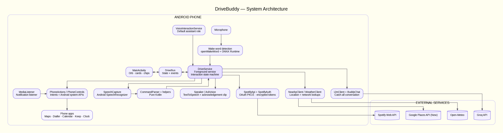

<p align="center">
  
</p>

# DriveBuddy

**A hands-free voice buddy for the driver's seat.** Say "Hi Oreo", get an instant spoken acknowledgement, and ask for what you need: navigate, call, text, play music, set a timer, find a petrol pump, hear the news, or just have a chat. All without touching the phone, and without opening the app.

Built for one phone (OnePlus Nord 5, Android 15) and one driver, in Kotlin. Open-source parts wherever possible, no paid services, no backend of its own.

---

## Contents

1. [Why this exists](#why-this-exists)
2. [What it can do](#what-it-can-do)
3. [How an interaction flows](#how-an-interaction-flows)
4. [Architecture](#architecture)
5. [Technical design](#technical-design)
6. [Data, privacy and security](#data-privacy-and-security)
7. [Cost and quota design](#cost-and-quota-design)
8. [Product and business design](#product-and-business-design)
9. [Logging and diagnostics](#logging-and-diagnostics)
10. [Testing](#testing)
11. [Build and setup](#build-and-setup)
12. [Permissions](#permissions)
13. [Known limitations](#known-limitations)
14. [Roadmap](#roadmap)
15. [Credits and licences](#credits-and-licences)

---

## Why this exists

Google Assistant stays silent after "Hi Google"; you wait, unsure it heard you. Siri answers with a quick "Mhm". That half-second of feedback is the difference between trusting a voice assistant and fighting it, and in a car with no Bluetooth and no steering-wheel button, the voice assistant is the only safe interface.

DriveBuddy is the answer to that one pain point, grown into a "holistic buddy" rather than a bag of commands:

- **Instant acknowledgement.** A short spoken clip plays the moment the wake word is heard.
- **Always reachable.** Runs as a foreground service and as the phone's assistant, so it works with the app closed and the screen locked.
- **Uses the phone's own apps.** Maps for navigation, Spotify for music, Calendar for reminders, Keep for notes, the Clock app for timers and alarms. Nothing is reinvented, nothing is duplicated.
- **Honest about failure.** It says what went wrong ("Spotify isn't connected") instead of going quiet.

It is a personal tool and a portfolio project, not a product for sale (see [Product and business design](#product-and-business-design)).

---

## What it can do

Phrases below are examples; the parser accepts natural variations.

| Area | What you can say | How it is done |
|---|---|---|
| **Wake and acknowledge** | "Hi Oreo" or tap the orb | Custom on-device wake-word model, then a short spoken ack clip |
| **Navigation** | "Navigate to Home", "Take me to Indiranagar" | Saved places and free-form addresses, opened in Google Maps. Last trips are remembered |
| **Calls** | "Call Papa" | Contacts name matching, then the system dialler. Works on a locked phone |
| **Text messages** | "Text Papa I'm on my way" or "Text Papa" then dictate | Reads the message back, asks yes/no, confirms real delivery with sent-intent callbacks |
| **Music (Spotify)** | "Play Husn by Anuv Jain" | Spotify Web API search, best-match picking, verified playback |
| | "Play a song by Anuv Jain" | Plays the artist, shuffled |
| | "Play any song" | Plays your Liked Songs, shuffled |
| | "Play my playlist driving", "a song from any of my playlists" | Plays your playlist, shuffled |
| | "Pause", "next", "previous", "stop" | System media session control |
| **Volume** | "Volume up", "set volume to 60", "mute" | Audio manager, reports before and after |
| **Timers and alarms** | "Set a timer for 10 minutes", "Alarm at 6:30 AM" | The Clock app's own intents |
| **Alarm check** | "What's my next alarm?", "Show my alarms" | Reads the next alarm from the system and opens the Clock's list. Turning an alarm off by voice is not possible on the OnePlus Clock (see [Known limitations](#known-limitations)), so "cancel my alarm" opens the list instead |
| **Reminders** | "Remind me to call the bank in 2 hours" | Created as Google Calendar events |
| **To-dos and notes** | "Add milk to my shopping list", "Note: parking is on level 3" | Handed to Google Keep |
| **App launching** | "Open WhatsApp" | Fuzzy matching on installed apps. Works on a locked phone |
| **Phone controls** | "Flashlight on", "Do not disturb on" | Camera torch and notification-policy APIs |
| **Weather** | "What's the weather?" | Open-Meteo, from your location |
| **Time and date** | "What's the time?", "What day is it?" | Read from the phone's clock, spoken in plain words |
| **Nearby places** | "Find a petrol pump near me" | Google Places search, nearest three as swipeable full-screen cards with distance and a rough drive time (tap or say 1, 2, 3, "more", "cancel"), then navigate. The card slides to each place as it is read out |
| **News** | "What's the news today?", "World news" | Latest headlines from public RSS feeds (The Hindu for India, BBC for world), five at a time as swipeable full-screen cards that follow the voice. Say a number or tap to open the story in the browser, "more" for the next five. Stories already read out are skipped for 24 hours, so asking again brings fresh ones |
| **Follow-up questions** | Any "which one?" or "shall I send it?" | The assistant listens again without needing the wake word |
| **Chat with Oreo** | "Tell me a joke", "How's it going?", or anything not covered above | Anything the rules don't recognise becomes a short spoken conversation with a free LLM (Groq). It keeps listening without the wake word; end it with "thanks" or "that's all", or stay quiet. A real command said mid-chat still runs normally |

Interruption works too: tap the orb while it is speaking and it stops and listens.

---

## How an interaction flows

```
"Hi Oreo"
   │  wake-word model fires (score ≥ 0.7, two frames in a row, loudness check)
   ▼
ack clip plays ──► music pauses ──► speech recogniser listens
   │
   ▼
transcript ──► CommandParser (pure Kotlin, rule-based) ──► Command
   │
   ▼
DriveService.respond(command)
   ├─ speaks a reply (TTS, with audio focus)
   ├─ then performs the action (Maps, call, Spotify, …)
   ├─ or asks a follow-up and listens again
   └─ or, for anything unrecognised, chats with the buddy (Groq LLM) and keeps listening
   │
   ▼
finishInteraction: log latency, resume music if appropriate, resume wake-word listening
```

Every stage is timed by a latency tracker and written to the log, so a slow interaction can be explained rather than guessed at.

---

### Architecture

The diagram below illustrates DriveBuddy's system architecture,
including its core Android components, voice interaction pipeline,
external APIs, and integrations.




### Main components

| Component | Responsibility |
|---|---|
| `service/DriveService` | The heart. Foreground service (microphone type). Owns the interaction state machine, follow-up questions, watchdog, audio focus and the wiring between every other piece |
| `DriveVoiceService`, `DriveSessionService`, `DriveRecognitionService` | Register DriveBuddy as an Android assistant, which exempts it from background-start limits so the wake word can launch a session with the app closed |
| `audio/OpenWakeWord`, `audio/WakeWord` | Wake-word detection loop on a background thread |
| `audio/SpeechCapture` | `SpeechRecognizer` wrapper: on-device engine preferred, restart-after-pause and release-after-each-result to avoid "busy" races |
| `audio/Speaker`, `audio/AckVoice`, `audio/Cue` | Text-to-speech, the "Mhm" ack clip, and short listening/ack beeps |
| `command/CommandParser` | Rule-based transcript-to-command router; every other `features/*` package keeps its pure, unit-tested logic next to the code that uses it (see [Testing](#testing)) |
| `features/phone/*` | Calls, SMS, navigation, app launch, torch, DND, timer, alarm, note, reminder, volume, media control |
| `features/music/*` | Spotify: OAuth with PKCE, encrypted token vault, search, playback, playlist and library reads, plus song and playlist matching |
| `features/nearby/*`, `features/weather/*`, `common/LocationHelper` | Network lookups and location |
| `features/news/*` | RSS client, headline cleaning, "not heard before" filtering and the 24-hour memory of what was read, spoken-number parsing |
| `features/clock/*` | Alarm and reminder time handling, spoken time and date, next-alarm lookup |
| `features/chat/*` | One call to Groq's chat endpoint, the conversation memory, and a per-day allowance kept on the phone |
| `service/OverlayAnchor` | A tiny overlay window so Maps and Spotify may be opened from the background |
| `features/music/MediaListener` | Notification-listener service giving access to active media sessions |
| `ui/DriveState`, `DriveBus` | UI state, choice cards, tap events and card-paging events, shared between service and screen |
| `ui/MainActivity`, `SettingsActivity`, `SetupActivity`, `PlacesActivity`, `JourneyActivity` | Home screen (including the swipeable cards), settings, first-run permission prompts, saved places, trip history |
| `features/navigation/*` | Small JSON stores for named places and the last ten trips |
| `ui/OrbView`, `ui/SettingsIconView` | The floating amber-to-violet orb and header icon |

### Project layout

Organised by feature, so everything for one capability sits in one folder.

```
app.drivebuddy
├─ DriveVoiceService, DriveSessionService, DriveRecognitionService
│                      system-bound entry points (kept at the root: Android stores them by name)
├─ service/            DriveService (interaction state machine), OverlayAnchor
├─ ui/                 MainActivity, SetupActivity, SettingsActivity, PlacesActivity, JourneyActivity,
│                      OrbView, DriveState (DriveBus), ReadAlong
├─ audio/              WakeWord, SpeechCapture, Speaker, AckVoice, Cue
├─ command/            CommandParser (Command, AlarmTarget), YesNo
├─ common/             LatencyTracker, LatencyLog, LocationHelper
└─ features/
   ├─ music/           spotify/* (auth, API, token vault, Pkce), PlayIntent, SongQuery, TrackPicker, MediaListener
   ├─ navigation/      SavedPlaces, Journeys
   ├─ nearby/          NearbyClient, NearbyText, PlaceChoice, TripEstimate
   ├─ news/            NewsClient, NewsText, NewsPicker, NewsSeen, StoryChoice
   ├─ weather/         WeatherClient, WeatherText
   ├─ chat/            LlmClient, BuddyChat, ChatQuota, DailyCap
   ├─ communication/   NameMatcher, SmsText
   ├─ clock/           AlarmTime, ReminderTime, TimeText, AlarmText, AlarmControls
   └─ phone/           PhoneActions, PhoneControls, AppMatcher
```

The unit tests mirror this layout. The next planned refactor is to give each feature its own small handler class so `DriveService` only routes.

---

## Technical design

### Wake word
- **Pipeline:** openWakeWord's `melspectrogram.onnx` → `embedding_model.onnx` → a custom-trained `hi_oreo.onnx`, run with `onnxruntime-android`.
- **Why custom:** off-the-shelf engines struggled with the owner's accent and with music playing in the car. A purpose-trained model for "Hi Oreo" fired on the first attempt.
- **False-trigger control:** a frame scoring 0.7 or more must repeat for two frames in a row (80 ms each), **or** one frame must reach 0.85, with a loudness check on top so near-silence can never wake it. The strong-frame rule exists because real wake-ups sometimes produce a single strong frame instead of two (seen in the logs); every real wake-up so far peaked at 0.85 or more, while every noise burst stayed under 0.8. The word "Oreo" alone can still trigger it (a conscious choice to leave it).
- **Why not Bluetooth or a button:** the car has neither, so the wake word is the only hands-free trigger. The power button is deliberately untouched.

### Always-on, no app open
- Runs as a microphone-type foreground service with a persistent notification offering Talk and Stop.
- Registers as the phone's default assistant. That status lets the service start from the background on Android 14 and later, which is what makes "Hi Oreo" work with the app closed.
- The service is deliberately **not sticky**: Android 14 and later will not let a killed microphone service restart itself, so it is started again by the assistant role or the user.

### Speech and speaking
- **Recognition:** Android `SpeechRecognizer`, on-device where available. The recogniser is released after every result, and restarted after the music-pause settles.
- **Acknowledgement:** a prerecorded "Mhm" clip plays first; listening begins only after it finishes, plus a short gap, so the assistant never hears itself.
- **Replies:** Android `TextToSpeech` under navigation-guidance audio focus. Music ducks or pauses, then resumes unless the command was itself a music command.
- **Watchdog:** a 15-second timer ends any interaction the recogniser never answers. Long network operations (location, search, Spotify wake-up) cancel it and own their own limits.

### Command understanding
- **Rule-based and on-device.** `CommandParser` turns a transcript into a sealed `Command`. Commands are never interpreted by a cloud model, so they stay near-instant and private. Only what the rules do not recognise goes to the [chat buddy](#chat-buddy).
- **Order matters.** Stop phrases → media → play → call → navigate → weather → time and date → news → alarm check and cancel → SMS → memory (notes, lists, reminders) → on/off switches → clock → open app → nearby → volume → chat buddy (the catch-all that used to just echo what you said). Music titles are matched before generic phrases so a song called "Turn Down for What" still plays.
- **Play requests** go through `PlayIntent`, which distinguishes a named song, an artist, "any song", a named playlist, and "any playlist", checking playlist phrases before artist phrases.
- **Matching helpers:** `NameMatcher` (contacts), `AppMatcher` (installed apps), `TrackPicker` (search results), `AlarmTime`, `ReminderTime`, `SmsText`, `YesNo`, `PlaceChoice`, `WeatherText`, `NearbyText`, `SongQuery`, `TimeText`, `BuddyChat`, `DailyCap`, `NewsText`, `NewsPicker`, `StoryChoice`, `AlarmText`.

### Chat buddy
Anything the rules do not recognise becomes a conversation with **Oreo** instead of an echo.

- **Where it plugs in:** only the old catch-all branch. Every recognised command takes exactly the path it always did, so nothing else can regress.
- **Model:** Groq's `openai/gpt-oss-120b` at low reasoning effort (up to 400 completion tokens; the spoken answer is kept to a couple of sentences by the prompt). Replies come back in roughly half a second to two seconds. A first choice, `llama-3.3-70b-versatile`, turned out to be retired on free tiers on 16 August 2026, which is why the model name lives in one constant in `LlmClient`.
- **It talks but never acts.** The system prompt states it cannot play music, navigate, call, text, set timers or open apps, and cannot see the phone, location, weather or traffic. If asked, it tells the driver what to say instead ("try saying: set a timer for ten minutes"). This prevents "Done, I've set it" when nothing happened.
- **Written for speech:** one or two plain sentences, no lists, markdown or emoji. `BuddyChat.tidy` strips symbols and trims long replies at a sentence end.
- **Garbled input:** the speech recogniser sometimes mishears, so the prompt tells the model to take every sentence as meant, and to say it did not catch something only when a sentence is truly unintelligible. (For example, "what's up" is sometimes heard as "WhatsApp"; this is left as is.)
- **No web access:** the model cannot look anything up, so it does not answer "what's the news"; that is a separate feature (see [News](#news)). It is told to say plainly when it cannot look something up, and never to send the driver to another app.
- **Conversation mode:** after each reply the service listens again with no wake word, using the same follow-up mechanism as SMS confirmation. The buddy remembers the last six messages. A conversation ends on "thanks" or "that's all", on silence (quietly, with no "sorry, I didn't catch that"), after eight exchanges, or when the driver taps to interrupt. A real command said mid-chat (for example "set a timer for 2 minutes") runs normally and ends the chat.
- **Limits and failures:** a daily cap of 100 chats (`ChatQuota` and the pure `DailyCap`), so a bug cannot burn the free allowance. Offline, rate-limited, key and server errors each get a short spoken explanation, and the log carries the provider's own error text.
- **What is sent:** only the unrecognised sentence and the last few chat messages. Never contacts, location, or anything from a recognised command.

### Choosing the right song
Spotify's top search result is a popularity-weighted guess, and since February 2026 its API no longer returns popularity at all. DriveBuddy therefore:
1. Turns "X by Y" into a field search (`track:"X" artist:"Y"`), retrying with plain words if that finds nothing (titles like "Stand by Me" contain "by").
2. Picks among up to 10 results by matching what you said against titles and artists, ignoring filler words, tolerating a one- or two-letter recogniser slip.
3. **Refuses to play when nothing plausibly matches**, and says so, rather than playing a random song.
4. Starts playback by album context plus offset (the form that reliably plays), then checks `/me/player` to verify the right track is actually playing.

### Follow-up conversations
`ask` / `askYesNo` / `startFollowUp` let any feature pose a question. After speaking it, the service listens again without a wake word. A mumbled yes/no is asked once more, then treated as no. This powers SMS confirmation, "what should I say?", the pick-one list and the location-settings prompt.

### Nearby places and the pick-one overlay
1. Location is read from the platform `LocationManager` (permission and the location switch are checked first, with a spoken offer to open settings).
2. A Google Places (New) Text Search runs with a deliberately cheap field mask (`displayName`, `location`).
3. Results are ranked by distance and offered three at a time, spoken and shown as swipeable full-screen cards (see [Swipeable cards that follow the voice](#swipeable-cards-that-follow-the-voice)). Each card shows the distance large and a rough "about N min by car", which is a straight-line estimate at city speed, not a live ETA. "More" fetches the next three; "Cancel" closes.
4. A tap interrupts the read-out and navigates immediately. A spoken "two" does the same. The chosen place is recorded as the last trip.
5. If the app is not in front (Maps is open), the assistant brings it forward so the list is visible.

### News
- **Source:** public RSS feeds, parsed with the platform `XmlPullParser`: The Hindu's national feed for "the news", BBC World for "world news". No key, no account, no model involved. A language model cannot browse the web, and free-tier search tools were judged unreliable and uncertain on cost, so a plain feed is the dependable choice.
- **Fresh every time:** `NewsSeen` remembers the links of articles already read out for 24 hours. Each request keeps only stories not heard before, so asking again five minutes later brings the next ones, and if nothing new has appeared it says so rather than repeating itself.
- **Reading and picking:** five headlines are shown and read as "Number 1 ... Number 5". A spoken number ("five", "number 4", "open story two", with common mishearings such as "for" or "tu" handled by `StoryChoice`) or a tap opens the article in the browser. "More" reads the next five; "done" ends.
- **Cards:** each card carries the headline in full and as much of the feed's summary as fits, with the source and a "Read story" button.

### Swipeable cards that follow the voice
News and nearby results are shown as one full-screen card per item inside a `ViewPager2`, with the next card peeking in at the edge. Both lists are read out loud, and the card moves to each item as it is spoken:

1. The text sent to text-to-speech contains known markers ("Number 3." or the place's name).
2. The speech engine's `onRangeStart` callback reports which character it is saying right now.
3. When that position reaches a marker, the screen is told to slide to that page (`DriveBus.slideTo`).

This tracks the actual voice, pauses and speed included. An earlier version estimated timing from text length and drifted by several seconds. If the user touches a card, auto-sliding stops for that card so a manual swipe is never overridden. If an engine sends no progress callbacks, the app logs a warning and the card stays on its first page. The pure part (finding the markers in the text) is `ReadAlong`.

### Alarms: what Android allows
The Clock app owns alarms, and Android gives other apps only a few hooks: setting an alarm, showing the list, and reading the **next** alarm time. DriveBuddy therefore answers "what's my next alarm" itself. It cannot list every alarm. The standard "dismiss alarm" request was tried on the OnePlus Clock: the Clock opens but ignores it for upcoming alarms, and there is no delete handler at all. So "cancel my alarm" says it cannot do that and opens the alarm list, instead of claiming success. Building DriveBuddy's own alarm engine was rejected because it would break the "use the phone's own apps" rule.

### Spotify
- **Auth:** OAuth 2.0 with PKCE (no client secret exists to leak). Tokens are encrypted with an Android Keystore AES-GCM key (`TokenVault`).
- **Playback:** needs Spotify Premium and Spotify installed. If the phone has no active device, DriveBuddy opens Spotify and waits up to about six seconds for it to appear.
- **Shuffle** is turned on for artists, Liked Songs and playlists, and turned off again for a specific song.
- **Scopes:** playback control, library read (Liked Songs) and playlist read. Adding scopes needs a one-time "Connect Spotify" again.

### Navigation and background launching
Maps is started with a `google.navigation:` intent. Android blocks background activity launches, so a small overlay window (`OverlayAnchor`, "Display over other apps") is shown during an interaction. That visible window is what allows Maps, Spotify and the Clock app to open while the screen is locked.

### State and UI
`DriveBus` is a small in-process event bus carrying the interaction state, status text, choice cards, tap events and card-paging events between the service and the activity. The UI is a single dark "night instrument" screen: a floating amber-to-violet orb, one headline, one status line, suggestion chips, the last trip, and a red "End session" pill. Pick-one lists open as swipeable full-screen cards. The launcher icon is the same orb, shipped as an adaptive vector icon with a themed single-colour variant, and the notification uses a white orb glyph (no image files, so it stays sharp at every size).

### Storage
Only small things, all on the phone: encrypted Spotify tokens, saved places (JSON), the last ten trips (JSON), the links of news articles already read out (for 24 hours), a daily chat counter, and a rolling latency log. Reminders live in Calendar and notes in Keep; DriveBuddy keeps no memory store of its own on purpose.

---

## Data, privacy and security

### What leaves the phone

| Service | What is sent | When |
|---|---|---|
| Android speech recogniser | Audio of your request | Each request. On-device when the engine supports it, otherwise the system's online recogniser |
| Spotify Web API | Search text, playback commands, your token | Music requests |
| Google Places API | The place type you asked for and your coordinates | "Find … near me" |
| Open-Meteo | Your coordinates, rounded to about 1 km | "What's the weather?" |
| The Hindu / BBC (news RSS) | Nothing beyond the request itself (the phone's IP address); no account, no cookies | News requests |
| Groq (chat) | Only the sentence DriveBuddy did not recognise, plus the last few chat messages. No contacts, location or message content | Chatting with Oreo |
| Google Maps | The destination | Navigation (via the Maps app, not DriveBuddy) |

There is no DriveBuddy server, no analytics SDK and no account.

### Safeguards
- **Wake-word audio stays on the phone.** Detection is fully on-device.
- **Secrets stay out of git.** The Maps/Places key lives in `local.properties` (git-ignored) and reaches the app through `BuildConfig.MAPS_API_KEY`. The Groq chat key is handled the same way (`GROQ_API_KEY`). The Spotify client ID is committed on purpose: with PKCE it is not a secret.
- **Tokens encrypted at rest** with a hardware-backed Keystore key.
- **Logs never contain** phone numbers or coordinates. Spoken text is logged as spoken, so contact names, search text, destinations, texts read back for confirmation and chat replies can appear, since the app is single-user and the log is the owner's. Redacting those is on the roadmap.
- **Confirmation before sending** any text message.
- **Least privilege:** each permission exists for a named feature (see [Permissions](#permissions)); permissions are requested on first run and can be re-toggled from Settings.
- **Locked-phone policy:** calls, texts and app launching deliberately keep working on a locked phone, because that is exactly when you are driving.

---

## Cost and quota design

The standing rule: **no spend, other than a card on file for Google Cloud, and only while usage stays inside free limits.**

| Piece | Cost                                                                        | Control                                                                                                                     |
|---|-----------------------------------------------------------------------------|-----------------------------------------------------------------------------------------------------------------------------|
| Wake word, parsing, TTS, recognition | Free (on-device)                                                            | N/A                                                                                                                         |
| Spotify Web API | Free; needs the owner's Premium for playback                                | Development-mode app, single user                                                                                           |
| Open-Meteo | Free, no key, non-commercial use                                            | Attribution below                                                                                                           |
| Groq (chat LLM) | Free tier, no card (limits change often, so **verify in the Groq console**) | An in-app cap of 100 chats a day, and the provider's own rate limit                                                         |
| News (RSS) | Free, public feeds | Headline and summary shown with a link to the publisher's page; nothing is stored beyond the article links read in the last 24 hours |
| Google Places (New) | Free monthly allowance (about 5,000 Pro-tier requests per month*)           | Cheap field mask (no ratings or opening hours); hard quotas of about 30 requests per day and 10 per minute in Cloud Console |
| Google Maps navigation | Free (uses the installed app)                                               | N/A                                                                                                                         |

Because quotas are enforced by Google rather than by the app, a bug or a loop cannot generate a bill. At the owner's expected use (a handful of nearby searches a month) the allowance is not approached.

---

## Product and business design

### Positioning
A **personal-use, portfolio-grade** assistant. It is not a public product and has no monetisation plan. Its value is two things: it fixes the owner's daily annoyance, and it is a demonstrable piece of engineering (on-device ML, Android system integration, third-party APIs, careful UX, tests and diagnostics).

### The user and the job
- **User:** one driver, one phone, English only, often in noisy conditions with music playing.
- **Job to be done:** "Let me do the handful of things I do in the car, by voice, quickly, and trust that it heard me."
- **Success measures (personal, not commercial):** wake word fires first time in the car; ack heard within about a second of the wake word; a request completes without touching the phone; no wrong-song or wrong-contact surprises; no bill.

### Design principles
1. **Acknowledge first.** Feedback in under a second beats a smarter but silent assistant.
2. **Reuse the phone.** Prefer the apps and features already installed over writing our own logic or depending on outsiders.
3. **Never guess silently.** Say what was understood, ask when ambiguous, admit when nothing matched.
4. **Safe by default while driving.** Confirm before sending, keep replies short, and prefer voice or one-tap choices over reading.
5. **Cheap and private.** On-device wherever possible, no backend, no ongoing cost.
6. **Diagnosable.** Enough logging to explain any interaction after the fact.

### Scope decisions (and why)
| Decision | Reason |
|---|---|
| Rule-based parser for commands; an LLM only for what the rules don't recognise | Commands stay instant, free and private; unrecognised talk gets a conversation instead of an echo |
| The chat buddy cannot take actions | Prevents false "done" claims; it suggests the phrase to say instead |
| Groq with `openai/gpt-oss-120b` for chat | Free, no card, fast, and no training on conversations. Gemini's free tier trains on data outside the EU/UK/EEA, and on-device Gemini Nano is blocked for background use |
| Spotify Web API over search-intent launching | Intents opened search but did not play; hands-free playback was a major requirement |
| Open-Meteo over reading the OnePlus Weather app | Works on any phone; reading another app's data was judged overkill |
| Calendar for reminders, Keep for notes | No second memory store to maintain; the phone's own apps already sync |
| News from RSS feeds, not from the chat model | The model cannot browse; a feed is free, fast and checkable, and gives article links |
| Alarm cancelling not built; "cancel" opens the Clock | The OnePlus Clock ignores dismiss requests for upcoming alarms; a private alarm engine or screen-tapping automation would break the "use the phone's own apps" rule |
| No photos on place cards | Google's place photos are a separate paid product; the cards use a big distance figure and a rough drive time instead |
| No calling by number | Judged unnecessary |
| No genre playback ("play a rap song") | Skipped for this milestone; Spotify's genre content is awkward for development-mode apps |
| No Bluetooth toggling | Blocked for apps on Android 13 and later |
| Wake phrase "Hi Oreo", English only | Matches the owner's choice and the trained model |

### Risks and mitigations
| Risk | Mitigation |
|---|---|
| Spotify tightens development-mode access (it did in Nov 2024 and Feb 2026) | Use only core playback endpoints; keep Spotify behind one small class; fail with a spoken reason |
| Android restricts background microphone or activity launches further | Assistant role plus overlay anchor; service designed to restart cleanly |
| Recogniser mishears names and titles | Fuzzy matching, refuse-on-no-match, confirm-by-voice; recogniser hint phrases planned |
| Google pricing or free allowance changes | Hard quotas in the console, cheap field mask, a single client class |
| Free LLM models get retired (Groq retired its Llama models on free tiers on 16 Aug 2026) | One small client class, the model name in one constant, and errors logged with the provider's own message |
| Battery and always-on microphone | Wake-word model is small and runs on one background thread; sessions can be ended from the home screen |
| Distraction while driving | Short spoken replies, large tap targets, voice-first flows |

---

## Logging and diagnostics

- **One tag:** `DriveBuddy`. Filter Logcat on it.
- **Levels:** `i` for flow milestones (state changes, transcripts, decisions), `d` for detail, `w` for recoverable problems, `e` for failures.
- **Every interaction** logs: trigger, state transitions, transcript and engine, routed command, spoken reply, action result, and (for Spotify) the HTTP status of each call plus a player check after playback.
- **A latency tracker** timestamps trigger, listening, speech end, ack, final transcript, routing and speech start/finish, and appends a JSON line per interaction so slow stages are obvious.
- **Not logged by design:** phone numbers and coordinates. Spoken replies are logged as spoken (see the privacy section).
- **Chat turns** log how many earlier exchanges there were, the day's count, the provider's response time and the reply length. Failures include the provider's own error text.

---

## Testing

Everything that can be Android-free is, so it can be unit-tested on the JVM: `CommandParser`, `PlayIntent`, `SongQuery`, `TrackPicker`, `NameMatcher`, `AppMatcher`, `AlarmTime`, `ReminderTime`, `SmsText`, `YesNo`, `PlaceChoice`, `WeatherText`, `NearbyText`, `TimeText`, `BuddyChat`, `DailyCap`, `Pkce`, `NewsText`, `NewsPicker`, `StoryChoice`, `ReadAlong`, `TripEstimate`, `AlarmText`.

```
./gradlew test
```

Anything involving the microphone, Maps, Spotify, location or the lock screen is tested by hand on the device, driven by the log lines described above. A recommended manual checklist before a drive: wake from locked screen; "navigate to home"; "call" a contact; send a text; play a named song, an artist, "any song", a playlist; "stop"; a nearby search with a tap and with a spoken pick; "what's the time"; a chat that continues without the wake word and ends on "thanks", on silence and on a command said mid-chat; the news twice in a row (the second time must bring different stories), a story opened by number and by tap, and cards that slide as the headlines are read.

---

## Build and setup

**Requirements:** Android Studio, a physical Android 15 phone (the wake word and assistant role cannot be tested on an emulator), Spotify Premium for music.

1. **Clone** the repo and open it in Android Studio.
2. **Maps / Places and chat keys.** Create a Google Cloud project, enable *Places API (New)*, add a billing card, create an API key restricted to your app and that API, and set quotas (about 30 `SearchText` requests per day and 10 per minute). Then add to `local.properties` (never commit it). The second line is the free Groq key for the chat buddy, created at console.groq.com; both are exposed as `BuildConfig` fields by `app/build.gradle.kts`:
   ```
   MAPS_API_KEY=your_key_here
   GROQ_API_KEY=your_key_here
   ```
3. **Spotify.** Create an app in the Spotify Developer Dashboard, add your account as a user, set the redirect URI used in `SpotifyAuth`, and put the **client ID** in the code (PKCE needs no secret).
4. **Wake-word models.** Place `melspectrogram.onnx`, `embedding_model.onnx` and your trained `hi_oreo.onnx` in the app's assets. The training notebook used for the custom model is included in the project notes.
5. **Ack clip.** Put the acknowledgement audio in `res/raw/ack.mp3`.
6. **Run** the app. The setup screen prompts for each permission in turn.
7. **Make it the assistant.** Android Settings → Apps → Default apps → Digital assistant app → DriveBuddy, so it can start with the app closed.
8. **Background location.** For nearby search and weather from an assistant-started session, grant location as **"Allow all the time"**.
9. **Connect Spotify** from Settings → Permissions.

---

## Permissions

| Permission | Used for |
|---|---|
| Microphone (+ foreground service, microphone type) | Wake word and speech recognition |
| Notifications | The persistent drive-session notification |
| Contacts | Matching names for calls and texts |
| Phone calls | Placing calls |
| Text messages (SMS) | Sending confirmed texts |
| Calendar (read/write) | Creating reminders |
| Location (fine, coarse, background) | Nearby places and weather |
| Display over other apps | Allowing Maps, Spotify and Clock to open from the background |
| Notification-listener access | Controlling the active media session (pause, next, resume) |
| Do Not Disturb access | Toggling DND |
| Set alarm | Timers and alarms through the Clock app |
| Internet | Spotify, Places, Open-Meteo, chat (Groq) |
| Kill background processes | Closing apps when a session ends |

---

## Known limitations

- Needs Spotify **Premium** and the Spotify app installed for music.
- Another app cannot cancel Google Maps navigation or read its current route.
- Timers, notes and to-dos are handed to other apps and **cannot be read back**; Keep needs one tap to save a note. Of the alarms, only the **next** one can be read; alarms **cannot be turned off by voice** on the OnePlus Clock.
- Spotify's own algorithmic playlists may refuse to play for a development-mode app.
- The recogniser sometimes mishears names and Hindi titles; DriveBuddy refuses to play a non-match rather than guess.
- "Oreo" on its own can trigger the wake word.
- The spoken three-place read-out is long (about 20 seconds) and five news headlines take about 40 seconds; tapping a card cuts it short.
- News depends on the feeds: a feed updates only now and then, so "nothing new since I last checked" is a real answer, and the summary line is whatever the publisher provides.
- Cards follow the voice only on speech engines that report progress (the default engine on the test phone does); drive times on place cards are straight-line estimates.
- The chat buddy is only as good as a small free model: it can be wrong, it cannot take actions, it is limited to 100 chats a day and eight exchanges per conversation, and it needs internet.
- The speech recogniser can mishear casual phrases (for example "what's up" as "WhatsApp"); the chat simply answers what it was given.
- Free LLM models can be retired by the provider without much notice (it has already happened once during this project).
- English only.

---

## Roadmap

Next, roughly in order:

1. **Multi-action commands:** "Take me home and play my driving playlist".
2. **Timers and reminders:** check and cancel by voice. Alarm checking is done; alarm cancelling is blocked by the Clock app (see [Alarms: what Android allows](#alarms-what-android-allows)).
3. **Spotify extras:** albums, "play that again", "not that one".
4. **Stop navigation** by voice (best effort).
5. **Recogniser hint phrases** built from your artists, playlists and contacts.
6. **Traffic, ETA and places along the route** with minimal detour (Google Routes API; free allowance and quota cap to be checked first).
7. **Housekeeping:** shorter spoken place list, tidier nearby-search label, remove leftover probe code, scan git history for secrets, and stop writing text-message bodies and chat replies into the log.
8. **News next steps:** "tell me more about story two" (short summary through the chat model), and mixing several feeds into one list.
9. **Code structure:** split `DriveService` into per-feature handler classes now that the files are grouped by feature.
10. **Chat buddy next steps:** start speaking the first sentence while the rest of the reply arrives, and consider the LLM as a second-chance intent parser for paraphrased commands (structured output, with a confirmation step).

---

## Credits and licences

- **Wake word:** [openWakeWord](https://github.com/dscripka/openWakeWord) (code under Apache 2.0). Check the licence of every model file you ship, including any pre-trained ones, before redistributing.
- **Inference:** [ONNX Runtime](https://onnxruntime.ai/) for Android (MIT).
- **Weather data by [Open-Meteo.com](https://open-meteo.com/)**, used under their free, non-commercial terms.
- **Chat:** conversations are served by [Groq](https://groq.com/), running OpenAI's open-weight `gpt-oss-120b` model (Apache 2.0). DriveBuddy is not affiliated with or endorsed by Groq or OpenAI.
- **News:** headlines and summaries come from the public RSS feeds of [The Hindu](https://www.thehindu.com/) and [BBC News](https://www.bbc.co.uk/news). They remain the publishers' content, shown with a link to the original article. DriveBuddy is not affiliated with or endorsed by either.
- **Logo and icon:** the orb is original artwork made for this project (`docs/orb-tight.svg`).
- **Music:** Spotify Web API. DriveBuddy is not affiliated with or endorsed by Spotify.
- **Places and navigation:** Google Places API (New) and Google Maps. Not affiliated with or endorsed by Google.
- Spotify, Google, Google Maps, Keep and Calendar are trademarks of their respective owners.